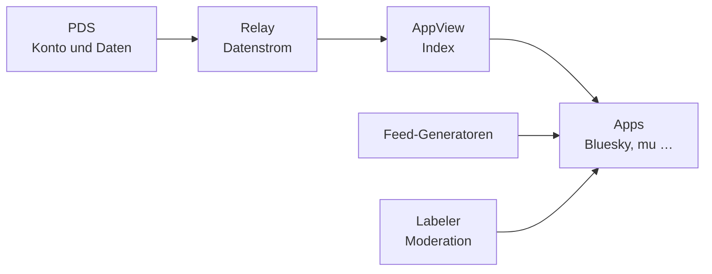

## Die Bausteine

- **PDS**: speichert Konto und Daten
- **Relay**: sammelt alle Änderungen
- **AppView**: bereitet sie für Apps auf

Note:
PDS = Personal Data Server, laut atproto.com „your home in the cloud“: speichert das Repository des Kontos (Beiträge, Likes, Follows als signierte Datensätze) und die Schlüssel. Ein PDS kann viele Konten hosten.

Relay: synchronisiert die Repositories aller PDS und erzeugt einen „Firehose“ aller Änderungen.

AppView: eine Anwendung, „just one view of the network“ – ähnlich wie eine Suchmaschine.

Lexicon: Schema-Sprache, mit der Apps ihre Datentypen definieren (z. B. app.bsky.* für Bluesky).
