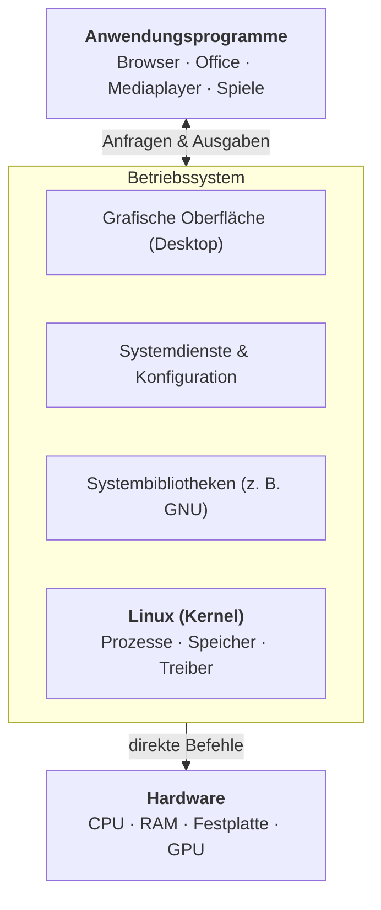

## GNU? Linux? Hä?

- **Linux** allein ist nur der Kernel: steuert die Hardware, verteilt Ressourcen
- **GNU** liefert Werkzeuge wie Shell, Compiler und Bibliotheken
- **Oberflächen** kommen z. B. von GNOME oder KDE
- Zusammen ergibt das ein Betriebssystem
- Die FSF nennt es deshalb **GNU/Linux**; üblich ist kurz „Linux“

Note:
Im alten Foliensatz stand „Korrekt daher eigentlich: GNU/Linux“. Das ist die Position der FSF und umstritten. Neutral: beide Namen nennen.

Diagramm gegenüber dem Original umgedreht: Hardware unten, Anwendungen oben. Die Befehle gehen vom Betriebssystem an die Hardware.
