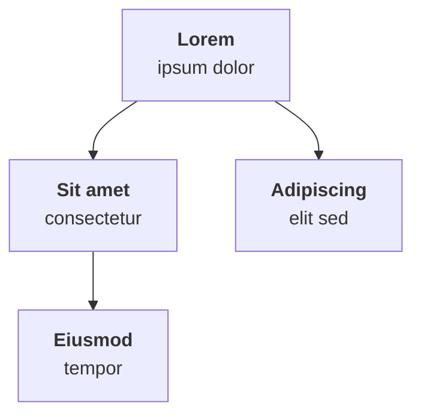

## Folientyp diagram

- Diagramm als `mermaid`-Block
- Farben folgen dem Theme
- Ohne weiteren Text nutzt das Diagramm die ganze Breite

Note:
Musterfolie **diagram**: Mermaid-Diagramm, im Browser gezeichnet (`src/vendor/mermaid.min.js`). Text außer der Überschrift steht rechts daneben.
